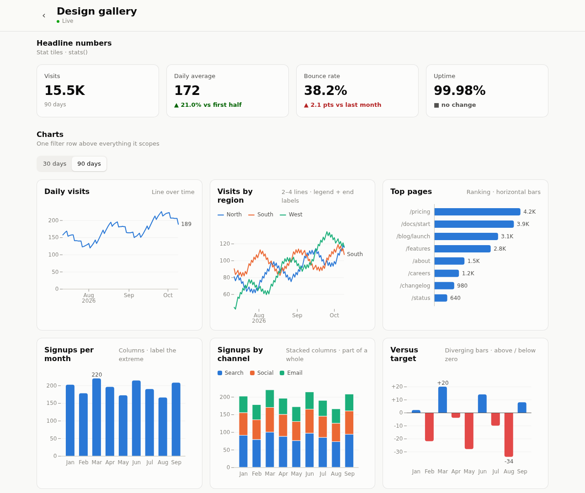
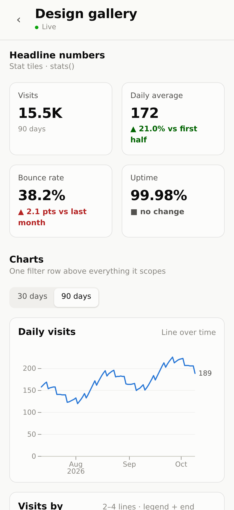
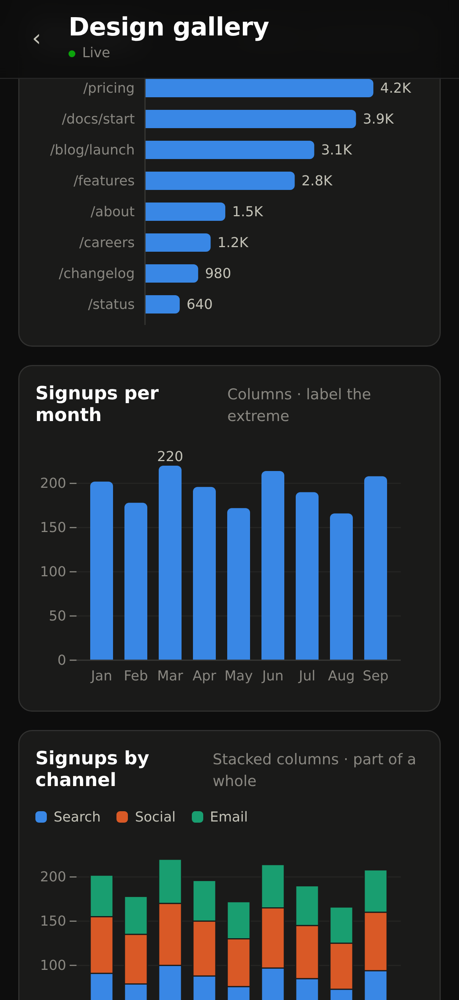

# omb-webreports

**Live, phone-first data reports for your [OpenMausBot](https://www.npmjs.com/package/openmausbot) bots.**

Your bots collect data into their DuckDB databases. omb-webreports publishes
those databases to a private, Tailscale-only website where bots build
**reports**: small, self-contained web apps with stat tiles, charts and
tables that query the data in the browser and update themselves when it
changes. Save any report to your iPhone home screen and it behaves like an app.



<p align="center">
  
  &nbsp;
  
</p>

## What you get

- **Reports your bots can build.** Ask a bot "make a report of …" or "make me a
  page with Cary's news, weather and the local team's results" and it writes an
  analysis report or a briefing from a template, using a shared kit (DuckDB-WASM, Observable Plot,
  sortable tables, stat tiles) and a documented design system, then checks it
  in a headless phone browser in light and dark mode before handing you the link.
- **Live data, no deploys.** When a bot's data changes, its database is
  re-published within seconds and every open report re-renders within ~20 s.
  Freshness is ETag-based: browsers revalidate (`304`), nothing is re-downloaded
  until it changes; shared code is cached under content-hashed URLs, so moving
  between reports fetches none of it. Each report's first render is pre-computed on the server
  after every change, so pages show their data in ~0.1–0.3 s without waiting
  for the in-browser database engine; filters then run live.
- **Scheduled data refreshes without AI.** After a bot collects data once, it can
  turn the collection into a plain script on a cron schedule (APIs, CSV/JSON,
  HTML, or JavaScript-rendered pages via headless Chrome). Runs are validated
  and applied atomically; a failure writes nothing and can ping the bot through
  an OpenMausBot webhook to fix it.
- **Locked down by default.** Reachable only from your tailnet, read-only
  (GET/HEAD), no server-side code, hardened Apache, sandboxed services.
- **Agent-ready.** Four [Agent Skills](skills/) (read, create and update reports;
  schedule data jobs), an agent guide ([READ_FIRST.md](READ_FIRST.md)), a
  design system ([DESIGN.md](DESIGN.md)) and a live component gallery.

## How it works

```
 OpenMausBot bot ──writes──▶ ~/.openmausbot/bots/<id>/data.duckdb
                                   │  webdata-sync (service): consistent copy,
                                   │  browser-compatible format, ~240 KB → ~8 KB on the wire
                                   ▼
 scheduled job ─────────▶ webroot/data/<bot>.duckdb + catalog.json
 (webdata-jobs service:            │  + reports/<slug>/initial.json: each report's first
  script → validate → apply)       │    render, baked in headless Chrome after every change
                                   │  Apache, tailnet only, ETag + Cache-Control: no-cache
                                   ▼
          phone / browser ── report = HTML + /lib/kit.js ── first render from the bake,
                             then DuckDB-WASM runs the SQL; polls ETags, re-renders on change
```

More in [docs/architecture.md](docs/architecture.md).

## Requirements

| | Tested with | Notes |
|---|---|---|
| Linux with systemd | Ubuntu 26.04 LTS | Debian-family (uses `apt`, Apache layout of Debian/Ubuntu). |
| [OpenMausBot](https://www.npmjs.com/package/openmausbot) | 0.1.104 | Running as a systemd service, as the same user that owns this checkout. |
| OpenMausBot's native modules | `@duckdb/node-api` 1.5.6-r.1, `@resvg/resvg-js` 2.6.2 | **Not shipped by the npm package.** Installed by [admin/openmausbot-upgrade.sh](admin/openmausbot-upgrade.sh); see [setup step 3](docs/setup.md#3-openmausbot-and-its-native-modules). |
| DuckDB-WASM (in the browser) | 1.33.1-dev65.0 = DuckDB v1.5.6 | Loaded from jsDelivr. **Kept on the same DuckDB version as OpenMausBot's** by the upgrade script, which won't move to a release without a matching build unless you say so. |
| Node.js | 24 (20+ required) | NodeSource packages. |
| Apache httpd | 2.4.66 | Installed by `admin/install.sh`; **dedicated to this site** (it rewrites `ports.conf`). |
| Tailscale | 1.104 | Private access + HTTPS via `tailscale serve`. |
| agent-browser + Chrome | 0.37.0 + Chrome for Testing 155 | `openmausbot browser install --with-deps`; used to check reports and to scrape JS-rendered pages. |
| Python 3, `acl` | 3.14 | Python for job scripts; `acl` installed by the installer. |

## Quick start

Full guide with explanations: **[docs/setup.md](docs/setup.md)**.

```bash
# 1–2: base packages, Tailscale; 3: Node.js, then (docs/setup.md):
git clone https://github.com/ckedwards/omb-webreports.git ~/omb-webreports
cd ~/omb-webreports
admin/openmausbot-upgrade.sh         # OpenMausBot + native modules + matching browser DuckDB
# 4–5: OpenMausBot service, Chrome (docs/setup.md)

$EDITOR config.env                   # set LISTEN_IP / SITE_URL if the defaults don't fit
sudo bash admin/install.sh           # Apache + services + tools on PATH
tailscale serve --bg --https=8443 http://$(tailscale ip -4):8080   # HTTPS for phones
webdata-info                         # paths, URL, versions, service status
```

Open `SITE_URL/reports/_gallery/` to see the design gallery, then teach your
bots the skills ([setup step 9](docs/setup.md#9-teach-your-bots-the-skills)).

## Using it

Talk to your bot:

- *"What reports do we have?"* · *"Send me the link to the season report."*
- *"Make a report of the batting stats: leaders, OBP vs. SLG, a sortable table."*
- *"Add a chart of runs per game to the season report."*
- *"Create a cron task to update this data hourly."*

From a shell:

| Command | What it does |
|---|---|
| `webdata-info` | install dir, site URL, versions, service status |
| `webdata-ls [reports\|data\|<slug>]` | list reports and published databases |
| `webdata-sql "<SQL>"` | query the published databases as reports see them |
| `webdata-new-report <slug> "<Title>" <db>` | scaffold a report |
| `webdata-check <slug>` | render a report at iPhone size, light + dark: errors, overflow, screenshots |
| `webdata-errors` | JavaScript errors reported by real browsers/phones |
| `webdata-bake <slug>` | re-bake a report's first render now (automatic after changes) |
| `webdata-job list\|run\|logs\|enable\|disable` | scheduled data jobs |
| `webdata-browse <url> --eval '<js>'` | headless Chrome for job scripts |

## Documentation

| | |
|---|---|
| [docs/setup.md](docs/setup.md) | Install everything, step by step (incl. the OpenMausBot DuckDB fix) |
| [docs/architecture.md](docs/architecture.md) | Components, data flow, freshness, security model, design decisions |
| [docs/operations.md](docs/operations.md) | Day-to-day commands, logs, troubleshooting, upgrades, uninstall |
| [docs/data-jobs.md](docs/data-jobs.md) | Scheduled data jobs and failure notifications |
| [docs/future-work.md](docs/future-work.md) | Improvements designed but not built yet, and when they'd be worth it |
| [READ_FIRST.md](READ_FIRST.md) | The guide agents read before touching reports (also `CLAUDE.md`, `AGENTS.md`) |
| [DESIGN.md](DESIGN.md) | The design system: layout, tokens, components, chart recipes, words |
| [skills/](skills/) | Agent Skills for OpenMausBot (SKILL.md format) |

## Repository layout

```
admin/install.sh         system side (Apache, systemd units, tools on PATH); run with sudo
admin/openmausbot-upgrade.sh  install/upgrade OpenMausBot + its native modules; keeps the
                         browser's DuckDB (DuckDB-WASM) on the same version as OpenMausBot's
bin/                     the webdata-* tools
config.example.env       settings template → config.env (git-ignored)
docs/                    user documentation
examples/reports/        a complete real report to study
jobs/                    your scheduled data jobs (git-ignored)
skills/                  Agent Skills for bots
templates/report/        the starter report webdata-new-report copies
webroot/                 the served site: front page, lib/ (kit), reports/ (yours are git-ignored)
```

## Status

A personal project that grew into a platform: tested on one machine
(Ubuntu 26.04, OpenMausBot 0.1.104), single user, Tailscale. Issues and pull
requests welcome.

## License

[MIT](LICENSE). Third-party components and their licenses: [THIRD_PARTY.md](THIRD_PARTY.md).
