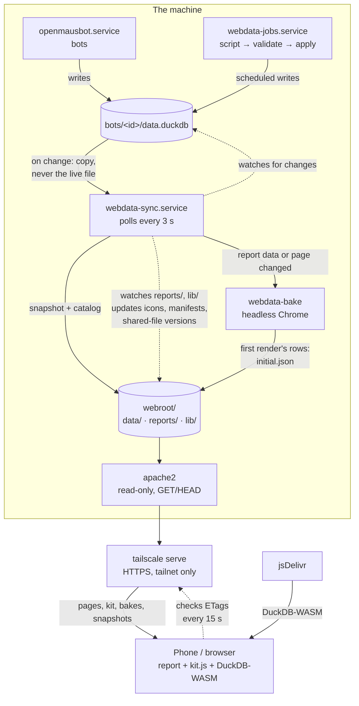

# Architecture

## Components

Dotted lines are polling: nothing pushes changes downstream. `webdata-sync`
checks the bots' databases and the report files every 3 s, and open pages check
the published files' ETags every 15 s (see [Data flow](#data-flow)).

The three services run as you; `webdata-sync` and `webdata-jobs` are
sandboxed (see [Security model](#security-model)). Apache runs as `www-data`
and listens only on `LISTEN_IP:LISTEN_PORT`.

| Part | Where | What it does |
|---|---|---|
| `webdata-sync` | `bin/webdata-sync --watch` | Polls every 3 s. Snapshots changed bot databases, writes the data catalog and report index, renders report icons and manifests, stamps module versions into pages. |
| `webdata-bake` | `bin/webdata-bake`, started by `webdata-sync` | Bakes each report's first render: runs it in headless Chrome and saves the query results to `initial.json`. |
| `webdata-jobs` | `bin/webdata-job daemon` | Cron scheduler for `jobs/*`: runs scripts, validates output, writes it into bot databases. |
| Apache | `/etc/apache2/sites-available/webdata.conf` | Serves `webroot/`: static files only. |
| kit | `webroot/lib/kit.js`, `kit.css` | Browser runtime every report uses: DuckDB-WASM, live updates, result cache, baked first render, charts, tables, design tokens. |
| Reports | `webroot/reports/<slug>/` | One directory each: `index.html`, `report.json`, `icon.svg`. One home-screen app each. |
| Tools | `bin/webdata-*` → `/usr/local/bin` | CLI for people and bots. |

## Data flow

1. A bot writes tables into its own `~/.openmausbot/bots/<id>/data.duckdb`
   (directly with its data tools, or through a scheduled job).
2. `webdata-sync` sees the file's size/mtime change. It **copies** the
   database (+ WAL) aside, never opening the bot's live file, then writes a fresh
   snapshot to `webroot/data/<bot name>.duckdb` with
   `STORAGE_VERSION 'v1.2.0', BLOCK_SIZE 16384`, and renames it into place atomically.
3. It describes every database in `webroot/data/catalog.json` (tables,
   columns, types, row counts) and the reports in `webroot/reports/index.json`.
4. A few seconds later, once the files have settled, `webdata-bake` renders
   each affected report headless and writes its first render's query results
   to `reports/<slug>/initial.json`; the page preloads that file.
5. A report page loads `/lib/kit.js` and draws from `initial.json` (or the
   browser's own result cache) when it matches the current database ETags.
   Anything else `ATTACH`es `/data/<bot>.duckdb` in DuckDB-WASM and runs the
   report's SQL in the browser.
6. While the page is visible, kit sends `HEAD` to each database (and to the
   page itself) every 15 s. A new ETag means the database is re-attached and the
   report re-renders; a changed page reloads.

## Design decisions

**Static site, SQL in the browser.** No server code to secure or keep
running; a report is one HTML file a bot can write. DuckDB-WASM attaches the
same database format the bots use, so reports run the same SQL the bot does.

**Snapshots, not the live file.** OpenMausBot keeps a bot's database open
for 10 minutes after use, and DuckDB allows one writer, so the live file can't be
read safely or served. The snapshot is also where format compatibility is
handled: the bots' DuckDB (1.5.x) is newer than DuckDB-WASM's engine (1.4.x),
so snapshots are written with a pinned storage version the browser can read.

**16 KB blocks + Brotli.** With DuckDB's default 256 KB blocks every small
table pads to whole blocks: a database with a dozen tiny tables was 3.4 MB.
16 KB blocks make it ~240 KB; Apache's Brotli makes that ~8 KB on the wire.
`BrotliAlterETag NoChange` keeps the ETag intact on compressed responses (the
default suffix breaks `If-None-Match`, so every visit would re-download);
`Range` requests are served uncompressed because a byte range of a compressed
stream is useless to DuckDB.

**ETags for data, versioned URLs for code.** Data files keep stable URLs;
`Cache-Control: no-cache` makes browsers revalidate every time (a `304`
when unchanged). Shared JavaScript modules are different: **Safari can run a
cached ES module without revalidating it**, even with `no-cache`, which broke a
report on an iPhone after `kit.js` gained an export. So every page carries a
`<!-- webdata:modules -->` block, maintained by `webdata-sync`, with an import
map pointing `/lib/kit.js` at `/lib/kit.js?v=<content hash>`. The sync also
stamps `?v=<content hash>` onto every other `src`/`href` into `/lib/`
(`kit.css`, `report-errors.js`, the vendored d3 and Plot), rewriting them in
place, so report authors write plain URLs. Apache serves `/lib/…?v=<12 hex>`
as `max-age=31536000, immutable`: a revisit, or a move to another report,
needs no request at all for shared code, only the page's own `304`. A changed
file gets a new URL; rewriting pages changes their ETags, so open pages and
home-screen apps reload. First visits still fetch every file (the price of no
build step: nothing is inlined).

**Result cache.** Starting DuckDB-WASM costs ~1–1.5 s even when its files are
cached (it compiles ~7 MB of WebAssembly). kit caches each query's rows in
IndexedDB keyed by page + SQL + the ETag of every attached database, so a
revisit with unchanged data renders in ~0.1 s without starting the engine. New
data means a new ETag, so the cache can't serve stale results. The engine still
starts, in the background once the page is idle after that render (DuckDB runs
in a worker, so scrolling isn't affected): a filter that needs a new query then
answers in tens of milliseconds instead of waiting 1–3 s for the engine.
`report({ warm: false })` skips that for a page with nothing interactive.

**Baked first render.** The result cache doesn't help a first visit, or the
first visit after new data, and with scheduled jobs that is every viewer after
every run. So after a report's data or page changes, the sync runs the report
once in headless Chrome (`?kit-bake`): kit runs the first render with the real
engine, records each query's rows, and `webdata-bake` saves them as
`initial.json`. kit uses those rows on the same terms as the result cache
(same SQL, same ETags), which takes a first visit from ~1.5 s to ~0.3 s and a
visit after new data from ~1.1 s to ~0.15 s on a desktop (more on a phone,
where the compile is slower). Choices behind it:
- *Data, not HTML.* Pre-rendered markup would be drawn at one width and one
  color scheme and redrawn on most devices; rows render correctly everywhere.
- *A separate file, not inlined.* Putting rows in `index.html` would change the
  page's ETag on every data change, and kit reloads open pages when that
  happens. The preload link has no version, so new bakes never touch the page.
- *Run the real page.* Only running the page knows its SQL, so bakes need no
  help from report code and always match what a browser would compute.
- *Outdated bakes.* In the seconds between a snapshot and its bake, kit draws
  the older rows marked "Updating…" and redraws with live data once the engine
  is ready. A bake that fails is deleted, so it can never linger.

**Scheduled jobs are scripts, not AI.** OpenMausBot routines re-run a bot (with
AI) on a schedule. Data refreshes should be deterministic, so a bot writes the
collection script once and `webdata-jobs` runs it. Scripts only *collect*: they
write files to `$WEBDATA_OUT`, and the runner validates (row counts, unique keys,
unchanged columns) and applies everything in one short transaction with the same
DuckDB build OpenMausBot uses, after waiting for OpenMausBot to release the file.
See [data-jobs.md](data-jobs.md).

**Skills are SKILL.md only.** OpenMausBot imports only `SKILL.md` (supporting
files are skipped for security), so all logic lives in `bin/` and the skills
call it. Skills contain no machine paths: they run `webdata-info` to learn
`ROOT` and `SITE`.

## Security model

What's exposed is a read-only static site on your tailnet. Assumptions: the
machine runs only this site's Apache; people on your tailnet may read every
published database.

**Apache** (`admin/install.sh` writes it):
- listens only on `LISTEN_IP:LISTEN_PORT`; `Require ip` limits clients to
  `ALLOWED_NETS` (Tailscale ranges by default); only `GET`/`HEAD`;
- `webroot/` is untrusted content: no `.htaccess` (`AllowOverride None`), no
  symlinks, no CGI/SSI/handlers (`SetHandler None`), no content negotiation;
- dotfiles and dot-directories are never served; `/` is denied by default;
- version hidden, `TRACE` off, `nosniff`, `X-Frame-Options: SAMEORIGIN`,
  `Referrer-Policy: no-referrer`.

**Filesystem.** Apache's user gets traverse-only (`x`) ACLs on the folders
above `webroot/` and read-only access inside it. It can't list your home,
the checkout, or OpenMausBot's data.

**Services** run as you, not root, with `NoNewPrivileges`,
`ProtectSystem=strict`, `ProtectHome=read-only` and a private `/tmp`.
`webdata-sync` can write only the checkout (its headless Chrome for baking
runs inside the same sandbox, with Chrome's own sandbox on); `webdata-jobs` (and every job
script) only the checkout and OpenMausBot's `bots/` folder.

**Jobs.** A job script runs unattended as you, inside that sandbox. The
data-job skill requires the bot to show you the script and get your explicit
OK before enabling it. Job secrets live in `jobs/<name>/.env` (git-ignored);
webhook URLs in `jobs/.notify.env` (git-ignored, `chmod 600`).

**Browser side.** Reports insert data with `textContent`, never `innerHTML`.
The only third-party code loaded at runtime is DuckDB-WASM from jsDelivr, at a
pinned version. `webdata-browse` uses a fresh, empty Chrome profile per call,
with Chrome's own sandbox on.

**Not covered:** authentication beyond network access (anyone on the tailnet
can read every report and published database: use `exclude_bots` in
`sync.json` for bots whose data shouldn't be published), and multi-user isolation.

## Files and state

| Path | Contents | In git |
|---|---|---|
| `config.env` | this machine's settings | no |
| `webroot/lib/`, `webroot/index.html`, `webroot/reports/_gallery/` | the platform | yes |
| `webroot/reports/<slug>/` | your reports | no |
| `webroot/data/` | published snapshots, catalog | no (generated) |
| `webroot/reports/<slug>/initial.json` | baked first render | no (generated) |
| `jobs/<name>/` | your data jobs | no |
| `.state/` | sync and bake state, the baker's Chrome profile, job status and logs | no |
| `/etc/apache2/…`, `/etc/systemd/system/webdata-*` | written by `admin/install.sh` | — |
| `/var/log/apache2/webdata-{access,error}.log` | Apache logs (incl. reported browser errors) | — |
