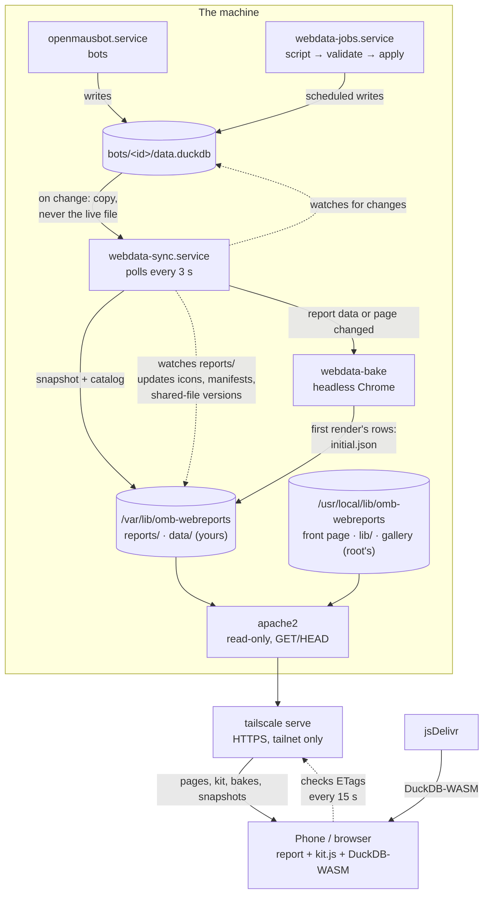

# Architecture

## Components

Dotted lines are polling: nothing pushes changes downstream. `webdata-sync`
checks the bots' databases and the report files every 3 s, and open pages check
the published files' ETags every 15 s (see [Data flow](#data-flow)).

The three services run as you; `webdata-sync` and `webdata-jobs` are
sandboxed (see [Security model](#security-model)). Apache runs as `www-data`
and listens only on `LISTEN_IP:LISTEN_PORT`.

| Part | Where | What it does |
|---|---|---|
| `webdata-sync` | `bin/webdata-sync --watch` | Polls every 3 s. Snapshots changed bot databases, writes the data catalog and report index, renders report icons and manifests, stamps module versions into pages. |
| `webdata-bake` | `bin/webdata-bake`, started by `webdata-sync` | Bakes each report's first render: runs it in headless Chrome and saves the query results to `initial.json`. |
| `webdata-jobs` | `bin/webdata-job daemon` | Cron scheduler for `jobs/*`: runs scripts, validates output, writes it into bot databases. |
| Apache | `/etc/apache2/sites-available/webdata.conf` | Serves the shared site files from the program and `reports/`, `data/` from the content folder: static files only. |
| kit | `/lib/kit.js`, `kit.css` (in the program) | Browser runtime every report uses: DuckDB-WASM, live updates, result cache, baked first render, charts, tables, design tokens. |
| Reports | `/var/lib/omb-webreports/reports/<slug>/` | One directory each: `index.html`, `report.json`, `icon.svg`. One home-screen app each. |
| Tools | `bin/webdata-*` → `/usr/local/bin` | CLI for people and bots. |

## Data flow

1. A bot writes tables into its own `~/.openmausbot/bots/<id>/data.duckdb`
   (directly with its data tools, or through a scheduled job).
2. `webdata-sync` sees the file's size/mtime change. It **copies** the
   database (+ WAL) aside, never opening the bot's live file, then writes a fresh
   snapshot to `data/<bot name>.duckdb` in the content folder with
   `STORAGE_VERSION 'v1.2.0', BLOCK_SIZE 16384`, and renames it into place atomically.
3. It describes every database in `data/catalog.json` (tables, columns,
   types, row counts) and the reports in `reports/index.json`.
4. A few seconds later, once the files have settled, `webdata-bake` renders
   each affected report headless and writes its first render's query results
   to `reports/<slug>/initial.json`; the page preloads that file.
5. A report page loads `/lib/kit.js` and draws from `initial.json` (or the
   browser's own result cache) when it matches the current database ETags.
   Anything else `ATTACH`es `/data/<bot>.duckdb` in DuckDB-WASM and runs the
   report's SQL in the browser.
6. While the page is visible, kit sends `HEAD` to each database (and to the
   page itself) every 15 s. A new ETag means the database is re-attached and the
   report re-renders; a changed page reloads.

## Design decisions

**Static site, SQL in the browser.** No server code to secure or keep
running; a report is one HTML file a bot can write. DuckDB-WASM attaches the
same database format the bots use, so reports run the same SQL the bot does.

**Snapshots, not the live file.** OpenMausBot keeps a bot's database open
for 10 minutes after use, and DuckDB allows one writer, so the live file can't be
read safely or served.

**The same DuckDB in the browser as on the server.** Reports run DuckDB-WASM;
the bots, sync, jobs and `webdata-sql` run OpenMausBot's `@duckdb/node-api`.
They're kept on the **same engine version**, so a query tested on the server
behaves the same in the browser and the browser reads exactly what the bots
write. DuckDB-WASM is a separate project with its own versions (1.33.1-dev65.0
contains DuckDB v1.5.6) and often lags a DuckDB release, so:
- `DUCKDB_WASM_VERSION` (`/etc/omb-webreports/config.env`) names the browser build; `webdata-sync`
  writes it into every page's import map, where kit reads it. Changing it
  re-stamps the pages and open ones reload.
- `admin/openmausbot-upgrade.sh` refuses (or asks) before installing an
  OpenMausBot release whose DuckDB has no DuckDB-WASM build yet, and names the
  newest release that has one. It sets `DUCKDB_WASM_VERSION` after upgrading.
- To tell which engine a DuckDB-WASM build contains (its package metadata
  doesn't say), `admin/duckdb-wasm.mjs` downloads the build's `.wasm` and calls
  DuckDB's own `duckdb_library_version()` in Node with stand-in imports; results
  are cached, since published builds never change.
- Snapshots still pin storage format v1.2.0 (needed for 16 KB blocks), which
  every DuckDB since 1.2 reads, so a browser that lags (after
  `--skip-browser-check`) can still open them.

**16 KB blocks + Brotli.** With DuckDB's default 256 KB blocks every small
table pads to whole blocks: a database with a dozen tiny tables was 3.4 MB.
16 KB blocks make it ~240 KB; Apache's Brotli makes that ~8 KB on the wire.
`BrotliAlterETag NoChange` keeps the ETag intact on compressed responses (the
default suffix breaks `If-None-Match`, so every visit would re-download);
`Range` requests are served uncompressed because a byte range of a compressed
stream is useless to DuckDB.

**ETags for data, versioned URLs for code.** Data files keep stable URLs;
`Cache-Control: no-cache` makes browsers revalidate every time (a `304`
when unchanged). Shared JavaScript modules are different: **Safari can run a
cached ES module without revalidating it**, even with `no-cache`, which broke a
report on an iPhone after `kit.js` gained an export. So every page carries a
`<!-- webdata:modules -->` block, maintained by `webdata-sync`, with an import
map pointing `/lib/kit.js` at `/lib/kit.js?v=<content hash>`. The sync also
stamps `?v=<content hash>` onto every other `src`/`href` into `/lib/`
(`kit.css`, `report-errors.js`, the vendored d3 and Plot), rewriting them in
place, so report authors write plain URLs. Apache serves `/lib/…?v=<12 hex>`
as `max-age=31536000, immutable`: a revisit, or a move to another report,
needs no request at all for shared code, only the page's own `304`. A changed
file gets a new URL; rewriting pages changes their ETags, so open pages and
home-screen apps reload. First visits still fetch every file (the price of no
build step: nothing is inlined).

**Result cache.** Starting DuckDB-WASM costs ~1–1.5 s even when its files are
cached (it compiles ~7 MB of WebAssembly). kit caches each query's rows in
IndexedDB keyed by page + SQL + the ETag of every attached database, so a
revisit with unchanged data renders in ~0.1 s without starting the engine. New
data means a new ETag, so the cache can't serve stale results. The engine still
starts, in the background once the page is idle after that render (DuckDB runs
in a worker, so scrolling isn't affected): a filter that needs a new query then
answers in tens of milliseconds instead of waiting 1–3 s for the engine.
`report({ warm: false })` skips that for a page with nothing interactive.

**Baked first render.** The result cache doesn't help a first visit, or the
first visit after new data, and with scheduled jobs that is every viewer after
every run. So after a report's data or page changes, the sync runs the report
once in headless Chrome (`?kit-bake`): kit runs the first render with the real
engine, records each query's rows, and `webdata-bake` saves them as
`initial.json`. kit uses those rows on the same terms as the result cache
(same SQL, same ETags), which takes a first visit from ~1.5 s to ~0.3 s and a
visit after new data from ~1.1 s to ~0.15 s on a desktop (more on a phone,
where the compile is slower). Choices behind it:
- *Data, not HTML.* Pre-rendered markup would be drawn at one width and one
  color scheme and redrawn on most devices; rows render correctly everywhere.
- *A separate file, not inlined.* Putting rows in `index.html` would change the
  page's ETag on every data change, and kit reloads open pages when that
  happens. The preload link has no version, so new bakes never touch the page.
- *Run the real page.* Only running the page knows its SQL, so bakes need no
  help from report code and always match what a browser would compute.
- *Outdated bakes.* In the seconds between a snapshot and its bake, kit draws
  the older rows marked "Updating…" and redraws with live data once the engine
  is ready. A bake that fails is deleted, so it can never linger.
- *Chrome on every data change.* A bake costs ~2.2 s and ~5 CPU-seconds, which
  is negligible at hourly refreshes. Replaying the recorded SQL natively when
  only data changed would cost milliseconds; it's designed but not built, see
  [future-work.md](future-work.md#replay-baked-queries-instead-of-re-rendering-in-chrome).

**Scheduled jobs are scripts, not AI.** OpenMausBot routines re-run a bot (with
AI) on a schedule. Data refreshes should be deterministic, so a bot writes the
collection script once and `webdata-jobs` runs it. Scripts only *collect*: they
write files to `$WEBDATA_OUT`, and the runner validates (row counts, unique keys,
unchanged columns) and applies everything in one short transaction with the same
DuckDB build OpenMausBot uses, after waiting for OpenMausBot to release the file.
See [data-jobs.md](data-jobs.md).

**Skills are SKILL.md only.** OpenMausBot imports only `SKILL.md` (supporting
files are skipped for security), so all logic lives in `bin/` and the skills
call it. Skills contain no machine paths: they run `webdata-info` to learn
`SITE`, `REPORTS`, `JOBS`, `DATA` and `DOCS`.

**Skills reach bots three ways, and stay current one way.** Each bot keeps its
own copy of a skill, so editing `skills/` changes nothing by itself.
- *Preset:* `skills/omb-webreports.openmaus.json` is an OpenMausBot package
  (its template format) generated from the skill files: the four skills and a
  "Report builder" preset with standing instructions. Its release only changes
  when the content does, so re-importing an unchanged package is a no-op.
- *`webdata-skills add <bot>`* for existing bots, or OpenMausBot's `/learn`.
- *`webdata-skills sync`* (run by `admin/install.sh` and
  `admin/openmausbot-upgrade.sh`) compares each bot's copy with the installed skills by
  SHA-256 and replaces outdated ones through OpenMausBot's API (remove, then
  install the new text; the old copy is put back if that fails), keeping each
  skill on or off as it was. It imports the current preset release and removes
  older ones. Only bots that already have an omb-webreports skill are touched.

Trust: a skill that was on stays on with the new text, without a review in the
app. The text comes from the installed program, which came from the
root-owned clone you chose to install; review `git log -p -- skills/` in the
clone before updating if you want to read changes first. The API calls are authorized as
described under "OpenMausBot isolation" below.

## Security model

What's exposed is a read-only static site on your tailnet. Assumptions: the
machine runs only this site's Apache; people on your tailnet may read every
published database.

**Code is root's, content is yours.** Bots run as the owner, so anything the
owner can write, a bot can change. Everything that runs as root, or that every
report runs, therefore lives where only root can write: the source clone
(`/usr/local/src/omb-webreports`), the installed program
(`/usr/local/lib/omb-webreports`: tools, skills, template, docs, `/lib/`, the
gallery, the front page) and the settings (`/etc/omb-webreports`). The owner's
content folder (`/var/lib/omb-webreports`) holds only what bots are meant to
write: reports, jobs, and the published data and state the services generate.
- The installer and update and OpenMausBot-upgrade scripts refuse a source
  that isn't root-only (the tree and every folder above it), unless given
  `--from-unsafe-dev` for development, which they log as unsafe
  ([development.md](development.md)).
- The installer copies an allowlist of files from the source (refusing
  unexpected symlinks), so a `git pull` never changes the running system by
  itself, and records the source and commit in `installed.json`.
- Root-run code never reads settings a bot could change: `config.env` is
  root-owned, so a bot can't redirect `OMB_URL` (and the session token) or the
  install paths. It never `source`s a file the owner can write (migration reads
  the old `config.env` as data), never runs git in a repository the owner can
  write (it runs git there as that owner), and changes things inside the content
  folder as the owner (`runuser`), not following symlinks.
- The services run the root-owned program as the owner, sandboxed.

**Apache** (`admin/install.sh` writes it):
- listens only on `LISTEN_IP:LISTEN_PORT`; `Require ip` limits clients to
  `ALLOWED_NETS` (Tailscale ranges by default); only `GET`/`HEAD`;
- every served folder is untrusted content: no `.htaccess` (`AllowOverride None`), no
  symlinks, no CGI/SSI/handlers (`SetHandler None`), no content negotiation;
- dotfiles and dot-directories are never served; `/` is denied by default;
- version hidden, `TRACE` off, `nosniff`, `X-Frame-Options: SAMEORIGIN`,
  `Referrer-Policy: no-referrer`.

**Filesystem.** Apache's user reads the program's site files (world-readable)
and gets traverse-only (`x`) on the content folder plus read-only ACLs on its
`reports/` and `data/` (also for new files). It can't read `jobs/`, `.state/`,
your home or OpenMausBot's data.

**Services** run as you, not root, with `NoNewPrivileges`,
`ProtectSystem=strict`, `ProtectHome=read-only` and a private `/tmp`.
`webdata-sync` can write only the content folder (its headless Chrome for
baking runs inside the same sandbox, with Chrome's own sandbox on);
`webdata-jobs` (and every job script) only the content folder and OpenMausBot's
`bots/` folder.

**OpenMausBot isolation.** OpenMausBot's API listens on `127.0.0.1`, and by
default on a self-hosted server it treats any request from this machine without
a login as its owner (`OMB_LOOPBACK_TRUST=owner`). Bots' shells run on this
machine, so a bot (say, one steered by a prompt injection in a page it read)
could switch on its own skills, loosen its own permissions or change settings
with a `curl`. With `OMB_LOOPBACK_TRUST=service` in `/etc/omb-webreports/config.env`
(the installer's default), `admin/install.sh` adds a systemd drop-in to
`openmausbot.service` and OpenMausBot refuses local requests that have no login
(they keep only health, the bot list and the bots' own per-turn routes, which
carry their own token). Requests that come through a proxy with forwarded
headers, such as your phone through `tailscale serve`, were never treated as
local and use their sessions as before. The webhook receiver (job failure
notifications) is unaffected.
- `webdata-skills` then uses **its own full-access OpenMausBot session**,
  stored in `/etc/omb-webreports/omb-session.json`, readable only by root. Bots
  run as you and can't use `sudo` without your password, so they can't read it;
  the admin scripts run as root, and you run `sudo webdata-skills …`.
- The installer creates the session before switching (while OpenMausBot still
  mints pairing codes for local requests). Later, `sudo webdata-skills login`
  needs a code from the app (Settings → Remote access).
- OpenMausBot ends a session after 30 days without use and after 180 days in
  any case, so the `webdata-omb-session.timer` (root, daily) uses it to renew it
  and swaps it for a new one every 30 days, revoking the old one.
- Side effect: OpenMausBot's own CLI can no longer pair devices or list
  sessions (`openmausbot pair` explains why); do that in the app instead.
- Not closed by this (OpenMausBot's own notes): a local caller can still post a
  message into any bot's thread through the guarded route.

**Jobs.** A job script runs unattended as you, inside that sandbox. The
data-job skill requires the bot to show you the script and get your explicit
OK before enabling it. Job secrets live in `jobs/<name>/.env` (git-ignored);
webhook URLs in `jobs/.notify.env` (git-ignored, `chmod 600`).

**Browser side.** Reports insert data with `textContent`, never `innerHTML`.
The only third-party code loaded at runtime is DuckDB-WASM from jsDelivr, at a
pinned version. `webdata-browse` uses a fresh, empty Chrome profile per call,
with Chrome's own sandbox on.

**Not covered:** authentication beyond network access (anyone on the tailnet
can read every report and published database: use `exclude_bots` in
`sync.json` for bots whose data shouldn't be published), and multi-user isolation.

## Files and state

| Path | Contents | Owner |
|---|---|---|
| `/usr/local/src/omb-webreports` | the source clone (installs and updates run from it) | root |
| `/usr/local/lib/omb-webreports` | the program: `bin/`, `skills/`, `templates/`, `examples/`, docs, `webroot/` (front page, `lib/`, gallery) | root |
| `/etc/omb-webreports/config.env` | settings | root |
| `/etc/omb-webreports/installed.json` | what's installed: source, commit, unsafe or not | root |
| `/etc/omb-webreports/omb-session.json` | webdata-skills' OpenMausBot session (0600) | root |
| `/var/lib/omb-webreports/reports/<slug>/` | your reports (and their generated icons, manifest, `initial.json`) | you |
| `/var/lib/omb-webreports/data/` | published snapshots, catalog (generated) | you |
| `/var/lib/omb-webreports/jobs/<name>/` | your data jobs | you |
| `/var/lib/omb-webreports/.state/` | sync and bake state, the baker's Chrome profile, job status and logs | you |
| `/var/cache/omb-webreports/` | which DuckDB engine each DuckDB-WASM build contains | root |
| `/etc/apache2/…`, `/etc/systemd/system/webdata-*` | written by `admin/install.sh` | root |
| `/var/log/apache2/webdata-{access,error}.log` | Apache logs (incl. reported browser errors) | — |
